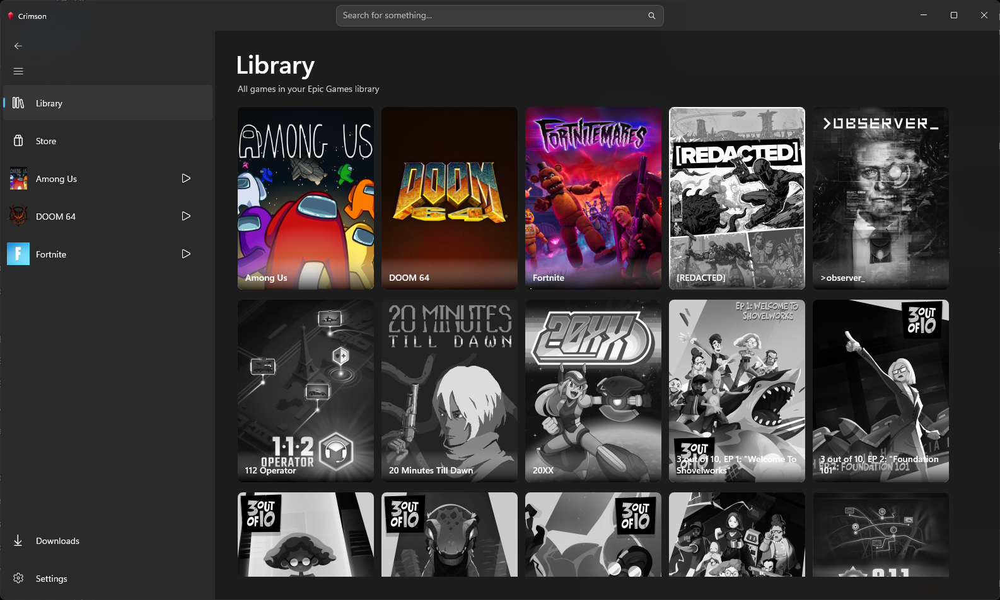
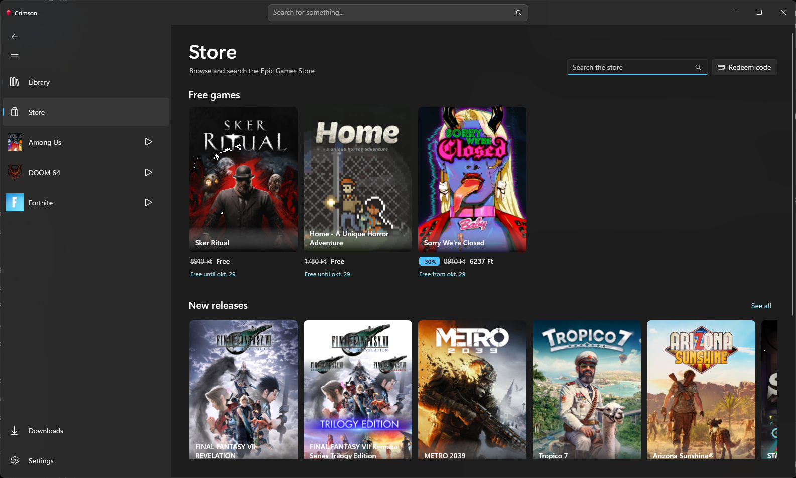
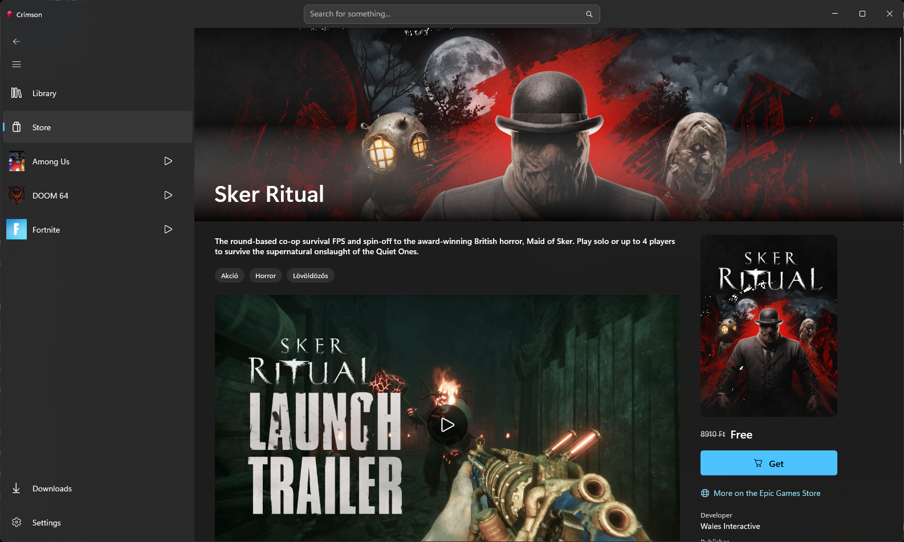
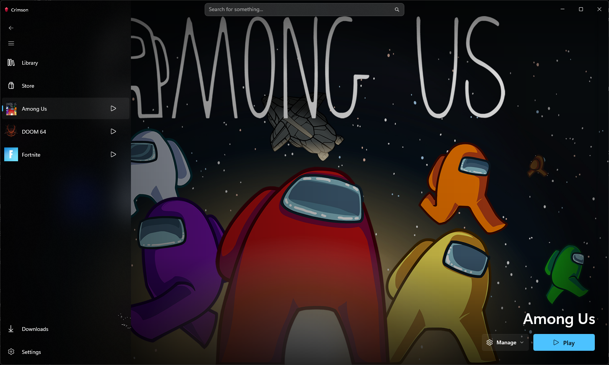
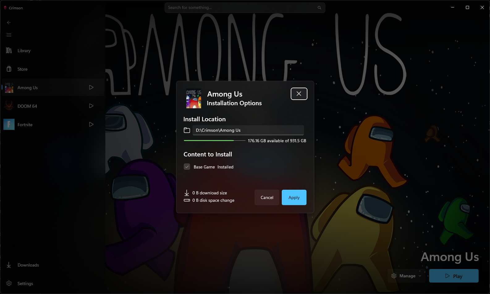
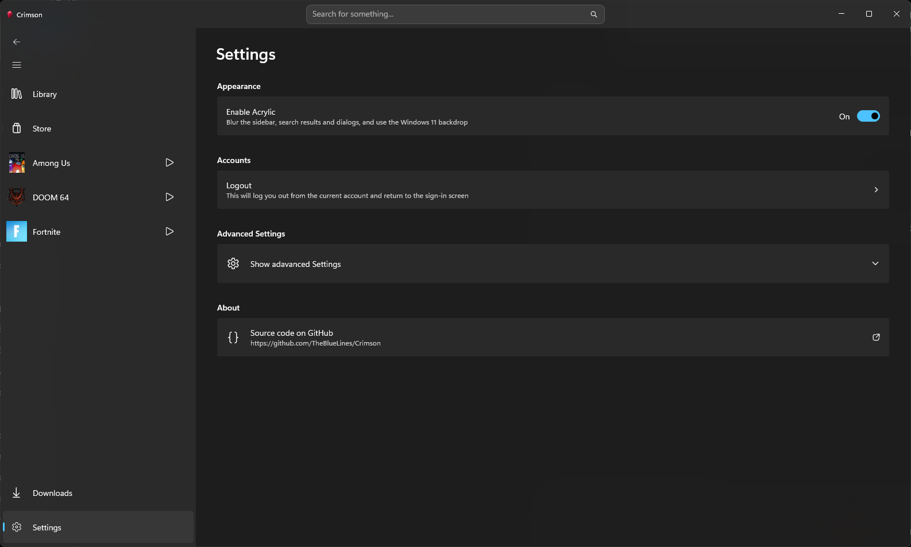

<p align="center">
  
</p>

<p align="center">
  A modern, fast and lightweight alternative to Epic Games Launcher.
</p>

<p align="center">
  <a href="https://github.com/TheBlueLines/Crimson/releases/latest"></a>
  <a href="LICENSE.txt"></a>
</p>

> [!IMPORTANT]
> Crimson is an independent, open-source project. It is not affiliated with, authorized by, or endorsed by Epic Games, Inc.

> [!NOTE]
> This repository is a fork of [Foxtrot47/Crimson](https://github.com/Foxtrot47/Crimson). See [Changes in this fork](#changes-in-this-fork) for what it adds.

## Screenshots

<p align="center">
  
  
</p>
<p align="center">
  
  
</p>
<p align="center">
  
  
</p>

## Features

- Sign in through Epic Games' embedded authentication flow.
- Browse your owned games with metadata and artwork.
- Search your library and the Epic Games Store from one place.
- Browse the Store natively, with product pages, media galleries, system requirements, ratings, and add-ons, and check out or redeem codes without leaving Crimson.
- Install, update, verify, repair, move, and uninstall supported games.
- Add or remove DLC and optional components of installed games.
- Pause, resume, or cancel downloads. Interrupted downloads resume where they stopped, even after a crash or reboot.
- Launch games with fresh Epic credentials and ownership tokens when required, and stop a running game from Crimson.
- Switch between an acrylic look and a solid one.
- Optionally create per-game Start menu and desktop shortcuts.

## Platform status

The current Crimson frontend supports **64-bit Windows 10 version 1809 or later** and requires the [Microsoft Edge WebView2 Evergreen Runtime](https://developer.microsoft.com/microsoft-edge/webview2/#download-section) for Epic sign-in and Store access. The runtime is already present on most current Windows installations.

The application is being separated into a portable core and platform-specific frontends, but Linux releases are not available yet.

Crimson is under active development. Back up anything important and expect behavior to change between pre-release versions.

## Install Crimson

Builds of this fork are published on the [GitHub Releases](https://github.com/TheBlueLines/Crimson/releases) page as a portable ZIP. The upstream project's releases additionally ship a signed MSIX.

### Portable ZIP

1. Download `Crimson-X.Y.Z-win-x64.zip`.
2. Extract the archive to a writable folder.
3. Run `Crimson.exe`.

The portable ZIP includes the required .NET runtime and does not require certificate installation. WebView2 remains a separate prerequisite.

### MSIX (upstream releases)

The upstream GitHub MSIX is signed with Crimson's persistent self-signed certificate:

1. Download the matching `.msix` and `.cer` files.
2. Import the certificate into the current user's **Trusted People** certificate store.
3. Open the `.msix` to install Crimson.

See [Installing and releasing Crimson](docs/RELEASING.md) for detailed installation steps, package differences, and checksum verification.

## Changes in this fork

Compared with [Foxtrot47/Crimson](https://github.com/Foxtrot47/Crimson) at the point it was forked:

- **Native Store.** The Store tab is rendered with WinUI pages instead of an embedded web page: free games, new releases, sales, paged search, and "see all" grids with sorting. Product pages show art, a media gallery, the full description, genres, system requirements, languages, player and critic ratings, add-ons, and regional prices. Owned games install, update, repair, or launch from their product page. The embedded web store is kept only for checkout and code redemption.
- **Manage installed content.** Add or remove DLC and optional components of an installed game. Files shared with other content are kept, and only installable add-ons are offered.
- **Resumable downloads.** The active install is checkpointed periodically and on exit, so a crash, reboot, or closed window no longer loses progress. Several paused installs can be kept at once, and starting one pauses the other. Cancelling a first-time install removes the files it wrote.
- **Install reliability.** Fixed chunks that Epic republished with a larger header, files without chunks, shared chunks, and progress stuck at 99%. DLC already present in an imported game's folder is detected, and failures are reported instead of leaving an action stuck.
- **Running games.** Games start from their executable's folder as the Epic Games Launcher does, which fixes Fortnite and Easy Anti-Cheat titles. Crimson can stop a running game, closing its windows gracefully first.
- **Artwork and appearance.** Remote artwork goes through a disk cache, newest request first. Game pages use the widest key art available. Acrylic can be turned on or off in Settings, and the title bar and sidebar were restyled.
- **Library and installs polish.** Covers are animated and sorted by install state, the default install folder is remembered, and install progress appears on the taskbar.
- **Sign-in and data.** Browser-based sign-in (e.g. Google) opens in the system browser. Packaged builds keep their data in the package's LocalState, so Windows' Reset and uninstall clear it.
- **Fixes.** The Library no longer crashes after visiting the Store, and uninstalling works again.

## Using Crimson

1. Launch Crimson and sign in with your Epic Games account.
2. Select a title from **Library**, or search from the title bar.
3. Choose **Install** and configure the location, optional content, and shortcuts. Use **Manage → Manage content** later to change what is installed.
4. Follow active and queued work from **Downloads**.
5. Launch an installed game from its page, the navigation pane, or a Crimson-created shortcut.

The **Store** shows free games, new releases, sales, and search results, with product pages that install or launch games you already own. Buying, claiming, and redeeming codes open Epic's web store inside Crimson. Newly acquired titles appear after Crimson refreshes account ownership.

## Local data and credentials

The portable build keeps its data under `%LOCALAPPDATA%\Crimson`. Packaged builds can map that location into Windows-managed package storage. Use **Settings → Open Logs Directory** to open the effective log location for the running build.

Application data includes logs, the embedded Epic sign-in and Store browser profile, cached metadata and artwork, manifests, and installation state.

Epic credentials stored by the Windows frontend are encrypted at rest with Windows Data Protection API (DPAPI). Crimson attempts to remove temporary ownership-token files after the game exits. Closing Crimson first or an interrupted shutdown can leave those files on disk.

## Build from source

### Requirements

- Windows 10 version 1809 or later, x64
- [.NET 10 SDK](https://dotnet.microsoft.com/download/dotnet/10.0)
- Visual Studio 2022 with **.NET desktop development** and the **Windows App SDK C# templates**

Clone the repository and run:

```powershell
dotnet restore Crimson.sln -r win-x64 -p:Platform=x64
dotnet build Crimson.WinUI/Crimson.WinUI.csproj -c Debug -r win-x64 -p:Platform=x64
```

Run the test suites with:

```powershell
dotnet test Crimson.Core.Tests/Crimson.Core.Tests.csproj -c Release
dotnet test Crimson.Tests/Crimson.Tests.csproj -c Debug -p:Platform=x64
```

MSIX packaging is intentionally opt-in:

```powershell
dotnet build Crimson.WinUI/Crimson.WinUI.csproj -c Release -r win-x64 -p:Platform=x64 -p:EnablePackaging=true
```

## Repository layout

- `Crimson.Core`: framework-neutral models, services, installers, and presentation state
- `Crimson.WinUI`: the Windows App SDK frontend and Windows platform adapters
- `Crimson.Core.Tests`: portable tests that also run on Linux CI
- `Crimson.Tests`: Windows-specific adapter tests
- `scripts`: deployment, packaging, and release validation tools

See [Installing and releasing Crimson](docs/RELEASING.md) for the tagged release process.

## License

Crimson is free software licensed under the [GNU General Public License v3.0 or later](LICENSE.txt). A copy of the license is included with binary distributions. Source for each tagged release is available from its matching `vX.Y.Z` tag in this repository.
